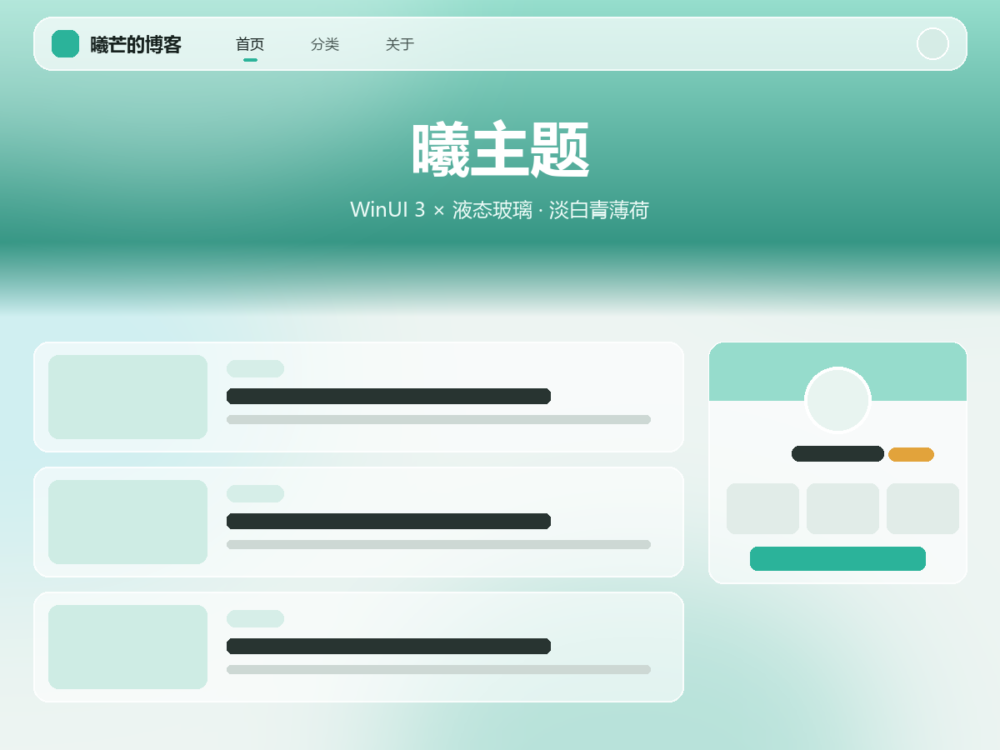

# 曦主题 XITheme

淡白与青薄荷配色的 WordPress 博客主题，WinUI 3 × 液态玻璃界面，模块化小工具，后台设置基于嵌入式 Codestar Framework（CSF）。

   



## 下载

前往 [Releases](https://github.com/ximangya/XITheme/releases) 下载最新版安装包 `xi-V1.0.zip`，在 WordPress 后台「外观 → 主题 → 安装主题 → 上传主题」中上传即可。

> 请下载 Releases 里的安装包，而不是 GitHub 自动生成的「Source code」压缩包：后者的目录名不是 `xi`，直接上传会导致主题名称和路径不一致。

## 主要功能

**界面与外观**
- 淡白 / 青薄荷配色，深浅色一键切换，主题色可自定义（深色模式可单独配色）
- WinUI 3 风格液态玻璃界面，圆角、模糊度可调
- 顶部多功能组件：幻灯片、搜索框、图标卡片、按钮组（7 种样式、6 种点击动作、动效）
- 站点美化：自定义字体、LOGO 扫光、动态标题、灵动岛提示、飘落特效
- 文章头图、阅读进度条、文章目录、相关文章、面包屑

**内容与编辑**
- 30 个编辑器区块：提醒框、标题、文件下载、折叠框、隐藏内容、选项卡、商品卡片、价格方案、优惠券、购买后可见、步骤、时间轴、视频、音乐、常见问题等
- 前台投稿编辑器（与后台区块同步，支持 `/` 快捷插入、图片拖拽上传、Markdown 快捷输入、本地自动保存）
- 隐藏内容：登录、评论、积分、会员、密码、指定用户组、定时公开
- 代码高亮、行号、一键复制
- AI 文章摘要（自定义接口）、多语言翻译、外链安全跳转

**用户体系**
- 前台弹窗登录 / 注册 / 找回密码，人机验证、邮箱与短信验证码（阿里云、腾讯云、短信宝）
- 第三方登录：QQ、微信、微博、GitHub、Gitee 官方接口，以及彩虹聚合登录
- 用户中心：资料、头像、封面、邮箱、手机、密码、收藏、订单
- 积分、余额、签到、卡密兑换、VIP 会员（两级）
- 权限管理（按用户组）、封号 / 禁言、IP 封禁
- 后台安全入口与应急面板：主题出问题时管理员也能进入后台

**商城**
- 商品：现金 / 积分 / 免费，多规格、库存、限购、限时折扣、会员折扣
- 发货：自动发卡、自动发货内容、人工发货、实物快递
- 购物车、收货地址、满减活动、优惠码、积分抵扣、运费与包邮
- 在线支付（易支付、支付宝官方）、余额支付、积分支付
- 订单：超时关闭、自动确认收货、售后（仅退款 / 退货退款）、商品评价
- 后台：订单管理、成交统计、导出 CSV、库存预警、商品复制

**论坛社区**
- 版块、帖子、话题、发帖、版主管理、置顶、每日发帖上限

**性能与 SEO**
- 查询缓存（支持 Redis / Memcached 对象缓存）、精简 WordPress 前台
- SEO 标签、FAQ 结构化数据、头像镜像（Cravatar / WeAvatar）

## 环境要求

| 项目 | 要求 |
| --- | --- |
| WordPress | 5.6 及以上（已在 7.1.3 测试） |
| PHP | 7.0 及以上（已在 8.5 测试） |
| 推荐 | 开启固定链接；国内站点建议配置 SMTP 发信 |

## 安装与升级

1. 下载 Releases 中的 `xi-V1.0.zip`
2. 后台「外观 → 主题 → 安装主题 → 上传主题」，上传并启用
3. 进入后台「曦主题设置」完成基础配置

升级时直接覆盖主题文件即可，主题设置、商品、订单数据全部保留；数据库结构会在首次访问时自动升级。

## 后台安全入口

启用主题后，在「曦主题设置 → 用户&互动 → 登录注册」中可以看到专属的后台安全入口地址，请妥善保存。前台登录异常、被锁定、误封 IP 或前台无法打开时，访问该地址即可进入后台和应急面板。

后台也无法进入时，可在 `wp-config.php` 中加入下面一行临时开启安全模式，修复后务必删除：

```php
define('XI_SAFE_MODE', true);
```

## 目录结构

```
xi/
├── assets/            前台样式、脚本、字体、第三方库
├── inc/
│   ├── codestar-framework/   后台设置框架（CSF）
│   ├── functions/            功能模块（用户、支付、商城、区块、论坛等）
│   │   └── shop/             商城模块
│   ├── options/              主题设置、文章与用户字段
│   └── widgets/              小工具
├── template-parts/    模板片段
├── functions.php      入口文件（只负责加载 inc/inc.php）
└── style.css          主题信息
```

## 更新日志

见 [CHANGELOG.md](CHANGELOG.md) 或 [Releases](https://github.com/ximangya/XITheme/releases)。

## 许可

曦主题基于 [GPLv2 或更高版本](LICENSE) 发布。

内置的第三方组件各自遵循其许可：
- [Codestar Framework](https://github.com/Codestar/codestar-framework)：GPLv2
- [Font Awesome 4.7](https://fontawesome.com/v4/)：字体 SIL OFL 1.1、CSS MIT
- [highlight.js](https://highlightjs.org/)：BSD-3-Clause
- [qrcode-generator](https://github.com/kazuhikoarase/qrcode-generator)：MIT
- [源泉圆体 GenSenRounded2](https://github.com/ButTaiwan/gensen-font)（ButTaiwan）字体子集：SIL OFL 1.1

## 作者

曦芒
